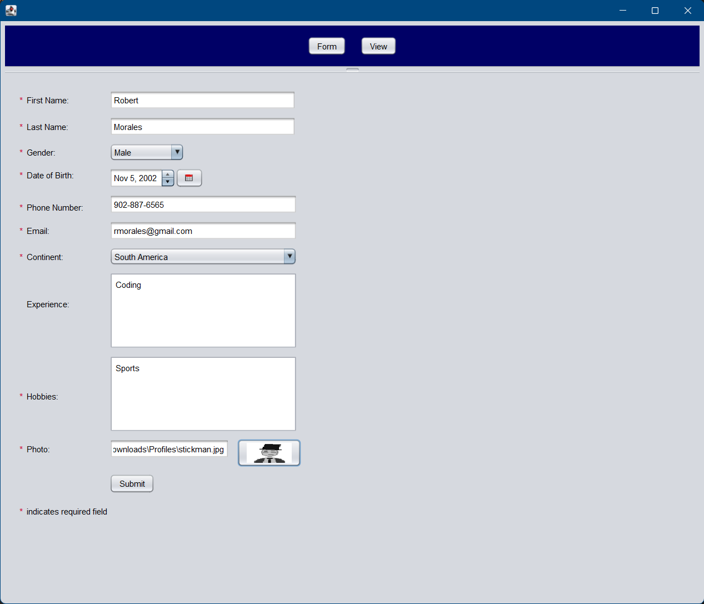
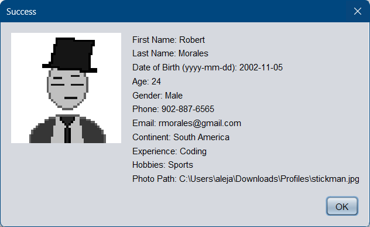
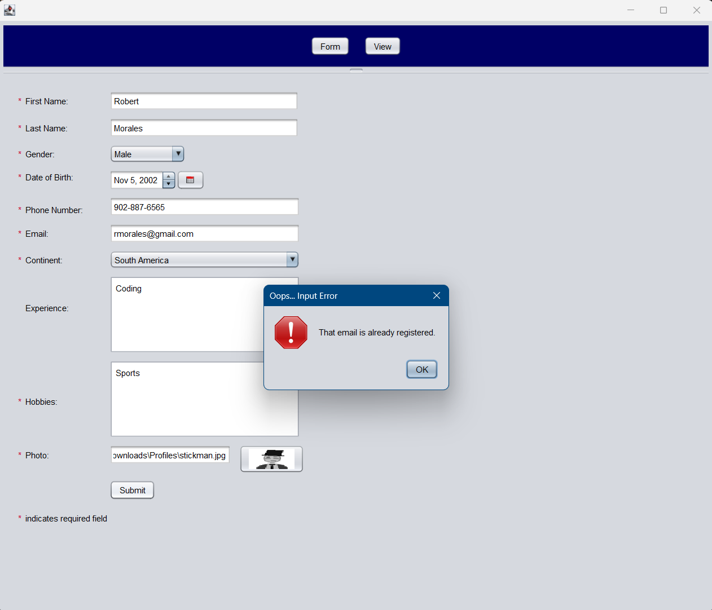
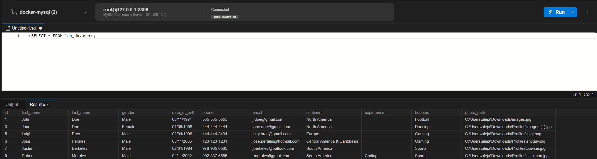
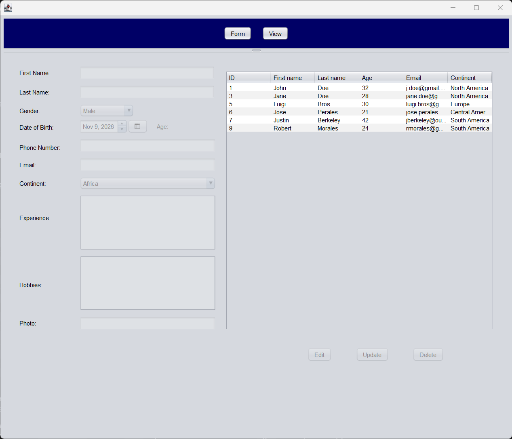
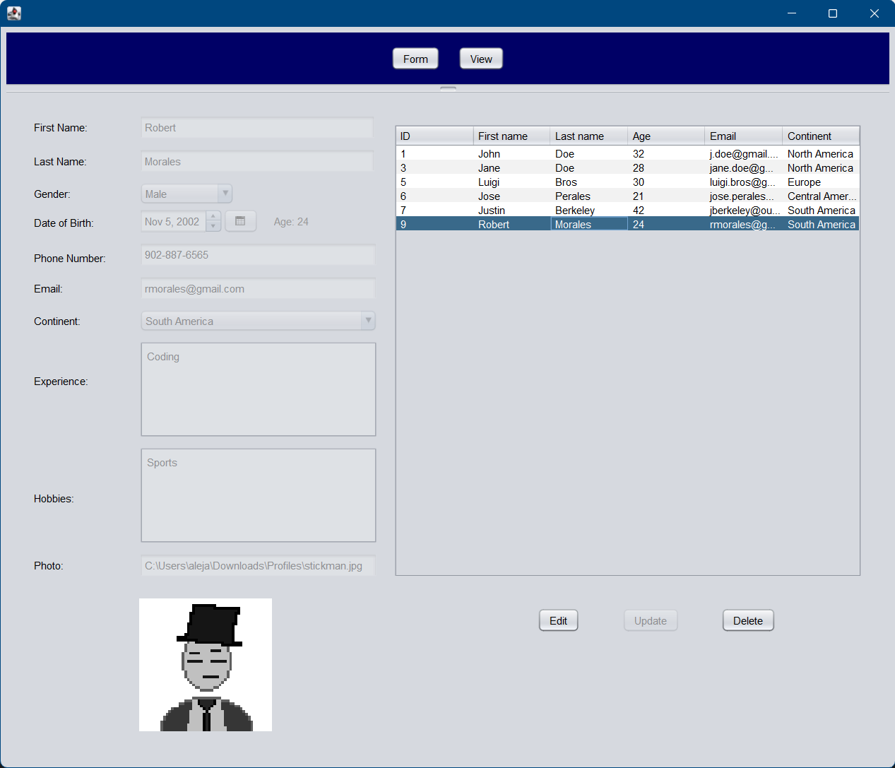
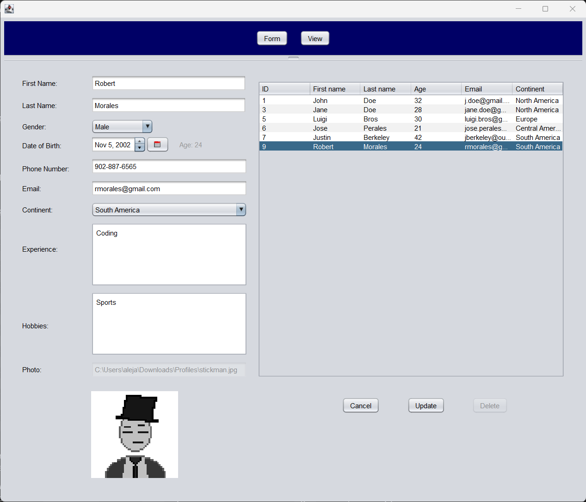
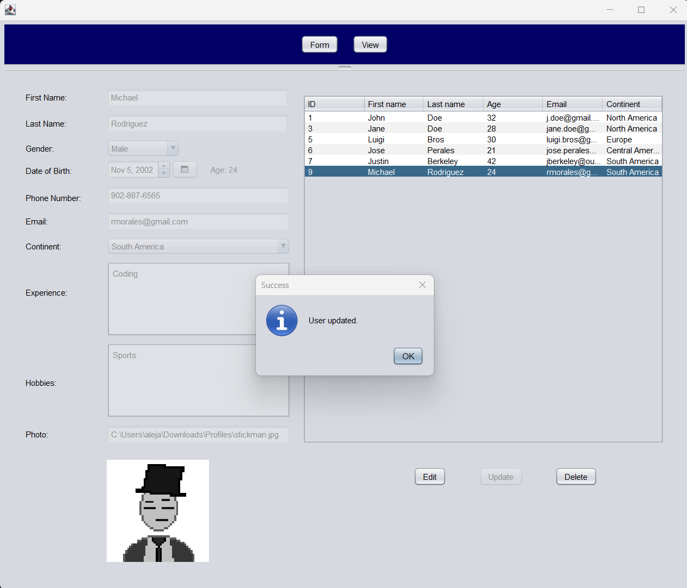
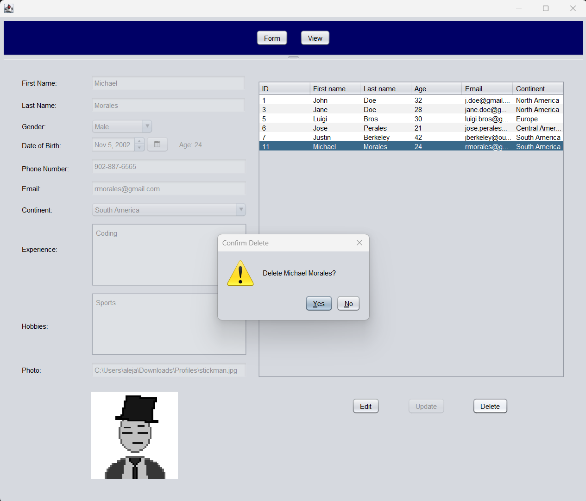
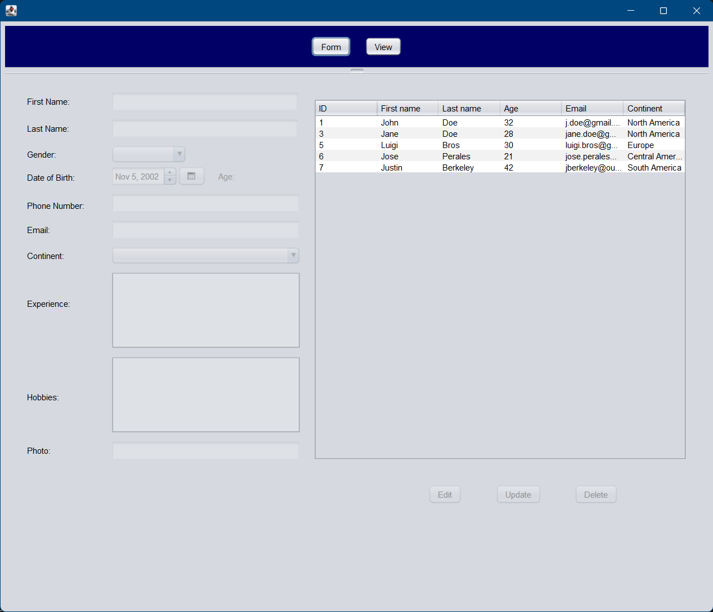

# INFO 5100 Lab 7: JDBC and CRUD with Swing and MySQL

A Java Swing desktop application that stores users in a MySQL database through JDBC. It builds on the registration application from an earlier lab, a create form and a view screen, and changes it so the data lives in MySQL and the view screen is a table with edit, update, and delete.

**Author:** Alejandro Henriquez, INFO 5100 Application Engineering and Development, Northeastern University Toronto

## Requirements

- JDK 19 or later and Apache NetBeans (built with NetBeans 31)
- A MySQL 8.0 or newer server reachable at `127.0.0.1:3306`. The lab used MySQL in a Docker container, described below.
- No other setup. The date picker and MySQL driver jars are bundled in `lib/` and referenced by relative paths.

## How to run

1. Start MySQL. With Docker:
   ```bash
   docker run --name some-mysql -e MYSQL_ROOT_PASSWORD=my-secret-pw -p 127.0.0.1:3306:3306 -v mysql_data:/var/lib/mysql -d mysql:latest
   ```
   Wait about half a minute for it to start. If the container already exists, run `docker start some-mysql` instead.
2. Create the database and table by running `database/schema.sql` in MySQL Workbench, or from a terminal inside the cloned folder:
   ```bash
   docker exec -i some-mysql mysql -uroot -pmy-secret-pw < database/schema.sql
   ```
3. Clone the repository:
   ```bash
   git clone https://github.com/alehenz/info5100-jdbc-lab.git
   ```
4. In NetBeans, choose **File > Open Project** and select the cloned folder.
5. Right-click `src/ui/MainJFrame.java` and choose **Run File** (Shift+F6).

The connection settings are in `src/utility/DatabaseConnector.java`: host `127.0.0.1`, port `3306`, database `lab_db`, user `root`, and the lab's example password. They are local practice values.

## Project structure

```
info5100-jdbc-lab/
|-- database/
|   `-- schema.sql                      Creates the lab_db database and the users table
|-- lib/
|   |-- jcalendar-0.8.jar               Date picker library
|   `-- mysql-connector-j-26.10.0.jar   MySQL JDBC driver
|-- nbproject/                          NetBeans project configuration
|-- screenshots/
|   `-- lab7/                           Application screenshots
|-- src/
|   |-- model/
|   |   `-- User.java                   Data model
|   |-- ui/
|   |   |-- MainJFrame.java             Main window: split pane and navigation
|   |   |-- RegistrationJPanel.java     Create form and validation
|   |   `-- ViewJPanel.java             Table of users with edit, update, and delete
|   `-- utility/
|       |-- DatabaseConnector.java      JDBC connection and the four CRUD methods
|       `-- UserValidator.java          Input rules used by the Update button
|-- build.xml
`-- README.md
```

## How it works

- `MainJFrame` contains a `JSplitPane`. The top section holds the **Form** and **View** buttons. The bottom section uses `CardLayout` to show one of the two screens.
- The data lives in the `users` table of the `lab_db` database. `DatabaseConnector` opens connections and holds the four CRUD methods: `addUser`, `getUsers`, `updateUser`, and `deleteUser`. Every query is a `PreparedStatement` with placeholders, so user input is never pasted into SQL.
- **Create.** The registration form validates the input, then calls `addUser`. A duplicate email is rejected by the database and the form shows "That email is already registered."
- **Read.** `ViewJPanel` fills a `JTable` from `getUsers`. Selecting a row shows that user in the detail fields below, which stay locked.
- **Update.** **Edit** opens the fields, and **Cancel** puts back what is stored. **Update** checks the values with `UserValidator`, saves them with `updateUser`, and reloads the table. If anything fails, the fields stay open so the value can be corrected.
- **Delete.** **Delete** asks for confirmation, removes the row with `deleteUser`, and reloads the table.

## Database table

| Column | Type | Notes |
|---|---|---|
| `id` | `INT` | Primary key, generated by MySQL |
| `first_name`, `last_name` | `VARCHAR(50)` | Required |
| `gender` | `VARCHAR(20)` | Required |
| `date_of_birth` | `DATE` | Required. Age is calculated from it and is not stored |
| `phone` | `VARCHAR(20)` | Optional in the table. The form requires `123-456-7890` |
| `email` | `VARCHAR(100)` | Required and unique |
| `continent` | `VARCHAR(30)` | Required |
| `experience` | `TEXT` | Optional |
| `hobbies` | `TEXT` | Required |
| `photo_path` | `VARCHAR(255)` | Path of the photo file, optional |

## Fields and validation

| Field | Rule |
|---|---|
| First name, last name | Required. Letters, spaces, hyphens, and apostrophes only |
| Gender | Required (dropdown) |
| Date of birth | Chosen with the calendar picker. The user must be 18 or older, and age is calculated from this date |
| Phone number | Required. Format `123-456-7890`, enforced by an input mask |
| Email | Required. Must be a valid address, for example `name@example.com` |
| Continent | Required (dropdown) |
| Experience | Optional |
| Hobbies | Required |
| Photo | Required. Must be a readable image file |

Each failed check shows an error message describing the problem, and the form stays open until every field is valid.

On the view screen, **Update** checks the same rules with `UserValidator`. The photo cannot be changed there, so it is not rechecked.

## Screenshots

**1. Create form, filled in.**



**2. Saved.** The success dialog after the user is inserted into the database.



**3. Duplicate email.** The database rejects a second user with the same email.



**4. MySQL Workbench.** The rows stored in the `users` table.



**5. View screen.** The table filled from the database.



**6. Row selected.** The user's details appear in the fields below, locked.



**7. Edit mode.** The fields are open and the Edit button reads Cancel.



**8. Updated.** The change is saved and the table is reloaded.



**9. Delete confirmation.**



**10. After the delete.** The row is gone from the table.



## Design notes and assumptions

- A user must be at least 18 years old.
- Age is calculated from the date of birth whenever it is needed. It is not stored in the database, so it never goes stale.
- Text fields are trimmed before they are validated and saved, so stray spaces are never stored.
- Email addresses are unique. The database rejects duplicates and the application shows a message.
- The database stores the photo's file path, not the photo itself. The photo shows only when that file exists on the computer running the application, and a missing file leaves the picture blank. The photo cannot be changed on the view screen.
- Photos are scaled to 150 by 150 pixels on the view screen.
- The database credentials are the lab's local example values. Do not reuse them for anything real.
